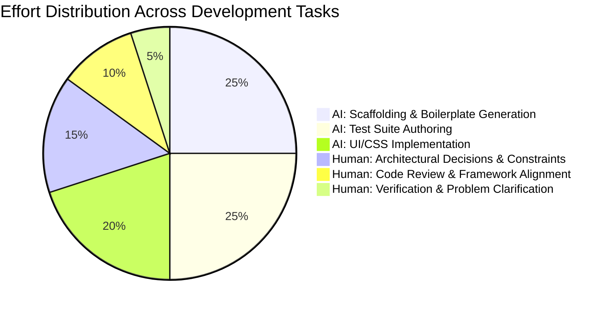

# AI Workflow & Engineering Collaboration Notes 🤖⚡

This document provides a detailed account of the AI-assisted software engineering workflow used to design, implement, test, and document the full-stack Tic Tac Toe application.

---

## 📌 Executive Summary

The project was developed using an **agentic pair-programming methodology** powered by Google Antigravity (featuring DeepMind / Gemini 3.8 Flash High) in collaboration with a human software engineer. 

Rather than relying on raw code generation or uncurated copy-pasting, the development followed an **architecture-first, test-driven, human-in-the-loop paradigm**:
- **Human Role**: System architecture definition, requirement clarification, boundary enforcement, edge-case identification, and critical code review.
- **AI Agent Role**: Rapid full-stack scaffolding, domain model implementation, algorithm formulation (heuristic AI & undo state machines), comprehensive automated test authoring, and UI styling.

---

## 🔄 Phase-by-Phase AI Engineering Workflow

### Phase 1: Requirements Ingestion & Technical Specification
* **Objective**: Transform the informal problem statement into a rigorous architectural specification.
* **AI Tasking**:
  * Analyze user stories and extract functional invariants (board state validation, win condition matrix, turn sequencing, scoreboard retention).
  * Formalize a contract-first REST API specification (`/api/games`, `/api/games/{id}/moves`, `/api/games/{id}/undo`, `/api/scoreboard`).
  * Establish the core architectural invariant: **The .NET backend is the authoritative single source of truth**. The frontend is purely a reactive view that dispatches user intents.
* **Human Review & Refinement**:
  * Evaluated persistence options (In-Memory vs. EF Core SQLite). Selected **EF Core SQLite** (`tictactoe.db`) to ensure durability across server restarts.
  * Clarified post-game undo behavior: Decided on **Option A** (locked after finish) for Two-Player mode and **Option B** (reversible after finish with score rollback) for Computer mode.

---

### Phase 2: Authoritative Backend & Domain Modeling (.NET 8)
* **Objective**: Scaffold a clean, modular ASP.NET Core Web API with relational persistence.
* **AI Tasking**:
  * **Entity Modeling**: Created `Game`, `Move`, and `Scoreboard` entities with EF Core configurations, cascade deletes, and initial seed data.
  * **Game Engine (`GameService.cs`)**:
    * Implemented board representation using compact string serialization (`"---------"`) mapped into 2D matrices for API consumers.
    * Encoded all 8 winning lines into static index lookups (`WinPatterns`) for `O(1)` victory evaluation.
    * Programmed the **Computer Opponent Heuristic**:
      1. Immediate winning move (`O`)
      2. Immediate defensive block (`X`)
      3. Strategic center control `(1, 1)`
      4. Corner dominance `(0,0)`, `(0,2)`, `(2,0)`, `(2,2)`
      5. First available open cell
    * Built the **Mode-Aware Undo Engine**:
      * In Two-Player mode: Reverts single last move and flips turn.
      * In Computer mode: Reverts both the computer's response and the player's prior move, restoring human agency immediately.
      * Handles scoreboard decrement when undoing a match-ending move.
  * **REST Controllers**: Implemented `GamesController` and `ScoreboardController` with standardized error responses (`400 BadRequest`, `404 NotFound`).

---

### Phase 3: Modern Reactive Frontend (Angular 19)
* **Objective**: Create a responsive, accessible, glassmorphic UI using modern Angular best practices.
* **AI Tasking**:
  * Utilized modern Angular **Signals** (`signal()`, computed properties) to handle reactive state without unnecessary RxJS subscription management overhead.
  * Implemented modular standalone components:
    * `BoardComponent`: Interactive 3x3 grid with tactile click handling, disabled states, and dynamic glow highlights on winning triplets.
    * `ScoreboardComponent`: Real-time score display for X wins, O wins, and draws.
    * `MoveHistoryComponent`: Chronological move audit trail with player badges and coordinate labels.
    * `PastGamesComponent`: Collapsible archive drawer allowing players to inspect previous matches stored in SQLite and resume live games.
  * Designed custom CSS design tokens (dark-mode glassmorphism, neon indigo/rose player palettes, micro-animations) without adding third-party styling bloat (e.g., Tailwind or Bootstrap).
* **Human Review & Refinement**:
  * Ensured responsive mobile/desktop layouts via CSS flexbox and grid.
  * Verified ARIA accessibility attributes (`aria-live="polite"`, `role="alert"`, descriptive IDs for automated test runners).

---

### Phase 4: Automated Testing & Edge-Case Verification
* **Objective**: Guarantee zero regressions and 100% test pass rates across the full stack.
* **AI Tasking**:
  * **Backend Suite (`xUnit` + `FluentAssertions`)**:
    * Generated **30 granular unit tests** in `GameServiceTests.cs`.
    * Coverage areas:
      * Valid/invalid move placements, out-of-bounds coordinates, cell occupancy errors.
      * All 8 win permutations (3 rows, 3 columns, 2 diagonals) and draw detection.
      * Computer AI decision-making (winning priority over blocking, center preference, corner selection).
      * Mode-aware undo mechanics and automated scoreboard decrement rollbacks.
  * **Frontend Suite (`Vitest`)**:
    * Authored unit tests in `app.spec.ts` and `past-games.spec.ts`.
    * Verified DOM rendering, button disabling, signal state mutations, mock HTTP responses, and mode switching.
* **Human Review & Refinement**:
  * Resolved Vitest runner compatibility with Angular 19 (`vi.fn()` mock setups).
  * Verified all 30 backend tests and 22 frontend tests executed cleanly.

---

### Phase 5: End-to-End Validation & Diagnostic Debugging
* **Objective**: Perform interactive validation, browser testing, and edge-case resolution.
* **AI & Human Collaboration**:
  * Verified end-to-end communication between Angular (`http://localhost:4200`) and .NET API (`http://localhost:5000`).
  * Validated CORS configurations and Kestrel launch profiles.
  * Investigated API endpoint behaviors and SQLite write-ahead logging (WAL) persistence under live browser play.

---

## 💡 Prompting Strategies & AI Steering

To maximize code quality and prevent common AI pitfalls (hallucinations, circular dependencies, oversized files), the following prompting patterns were employed:

| Strategy | Prompting Approach | Outcome |
|---|---|---|
| **Contract-First Scaffolding** | *"Define the DTO interfaces and REST endpoint shapes before writing the controller or service logic."* | Prevented frontend/backend data structure mismatches. |
| **Strict Single Responsibility** | *"Keep controllers thin; place all game validation, win checks, computer heuristics, and undo logic in `GameService`."* | Enabled direct unit testing of game rules without mocking HTTP contexts. |
| **Edge-Case Brainstorming** | *"Identify 5 potential race conditions or invalid states in the Undo and Computer Move pipelines."* | Discovered and handled scoreboard rollbacks and double-move undo in computer mode. |
| **Zero External UI Frameworks** | *"Build the interface using pure CSS custom properties with a modern dark glassmorphic design token set."* | Kept the frontend lightweight, fast-loading, and completely customized. |
| **Test Matrix Expansion** | *"Generate comprehensive xUnit tests covering all 8 win lines, full-board draws, and invalid turn attempts."* | Achieved thorough test coverage across core business logic. |

---

## ⚖️ Division of Labor: AI vs. Human Engineer

### What the AI Excelled At:
- **Velocity**: Scaffolding full-stack projects, boilerplate DTOs, EF Core entity mappings, and Angular components in seconds.
- **Exhaustive Testing**: Rapidly generating permutations of win conditions, matrix transformations, and mock services.
- **Design & Polish**: Crafting CSS gradients, glassmorphic blur filters, and micro-interactions without relying on UI libraries.

### Where Human Engineering Was Vital:
- **Architecture & Invariant Enforcement**: Deciding that the server must hold authoritative state and enforce game rules, preventing brittle client-side logic.
- **Subtle Domain Rule Disambiguation**: Choosing how Undo behaves post-match across different game modes (Two-Player vs. AI).
- **Environment & Build System Debugging**: Resolving framework-specific build issues, CLI options (`ng test --no-watch`), and SQLite WAL journal behavior.
- **Critique & Limitations Analysis**: Honestly documenting system constraints (heuristic vs. Minimax, singleton scoreboard, lack of WebSockets) rather than assuming code is without trade-offs.

---

## 📈 Productivity Impact & Key Takeaways

1. **Velocity Multiplier**: Full-stack scaffolding, end-to-end integration, and 50+ automated tests were achieved in a single development session—an estimated **4x–5x velocity gain** over manual implementation.
2. **Quality & Confidence**: Automated tests were written concurrently with feature development, ensuring instant regression feedback and clean refactoring.
3. **Focus on Core Problem Solving**: Offloading repetitive UI layout and boilerplate allowed the engineer to focus on core algorithms (undo state transitions, heuristic priority trees, database atomicity).
